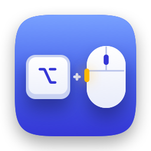
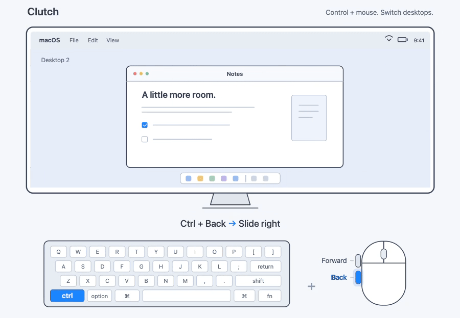
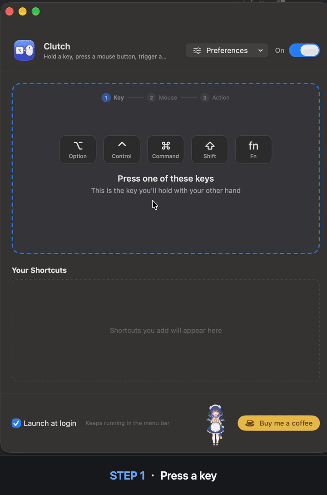
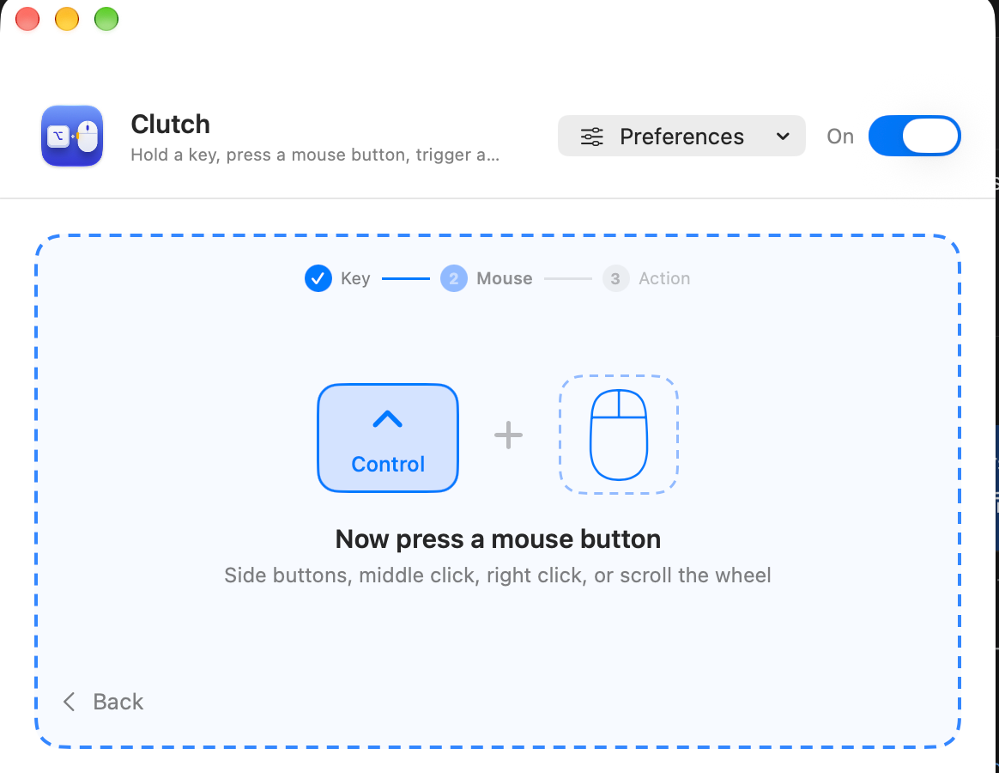
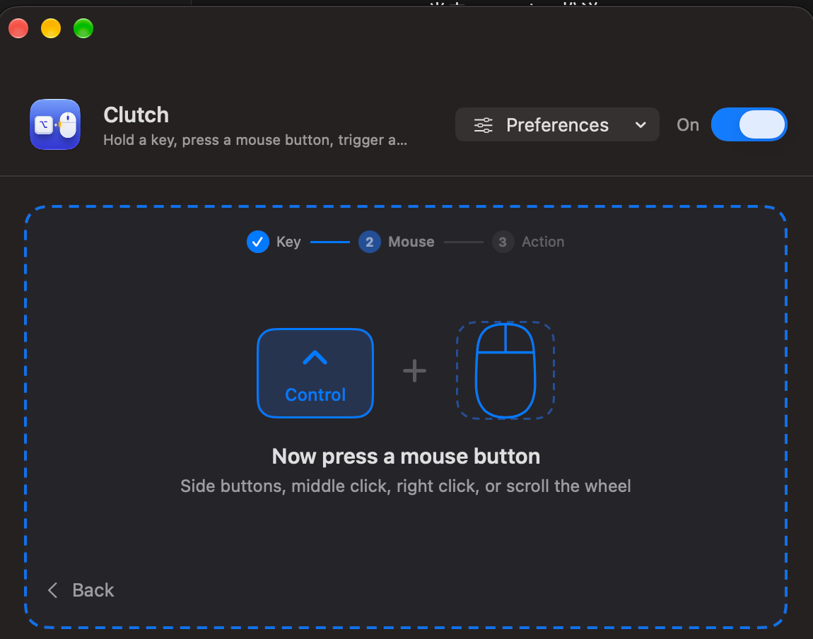

<!-- TODO: keep docs/assets/icon.png in sync with AppIcon (256×256 PNG displayed at 128 px) -->

# MouseSpell

### 鼠标不离手，手势全都有

按住键盘按键，再按鼠标按键，触发 macOS 系统手势。

[English](README.md) · **简体中文**

[访问官网](https://treattrick.github.io/MouseSpell/zh/) · [English](https://treattrick.github.io/MouseSpell/) · [日本語](https://treattrick.github.io/MouseSpell/ja/)

[下载 v1.0.1](https://github.com/TreatTrick/MouseSpell/releases/download/v1.0.1/MouseSpell-v1.0.1-universal.dmg) · [安装说明](#-安装) · [三步添加快捷键](#-三步添加快捷键) · [认识龙女仆](#-认识龙女仆)

 

<!-- TODO: expand desktop-switching-demo.gif with Mission Control and Show Desktop (aim for about 1200×700, under 10 MB)
     Hand on the mouse, Control held: click the forward side button → desktop slides left;
     click the back side button → desktop slides right.
     ⌥ + middle click → Mission Control opens, ⌥ + scroll down → Show Desktop.
     A keystroke overlay (e.g. KeyCastr) in the corner helps viewers follow along.
     The current desktop-switching-demo.gif is converted from a recording; the editable illustration remains in desktop-switching-demo.svg. -->

 

## 🖱️ 为什么选择 MouseSpell？

macOS 把许多好用的操作放在了触控板手势里：左右轻扫切换桌面、向上轻扫打开调度中心、张开手指显示桌面。换成鼠标后，你往往需要借助键盘快捷键，让握着鼠标的手暂时离开鼠标。

MouseSpell 让这些操作也能用鼠标完成。一只手放在键盘上，另一只手握住鼠标；按住一个修饰键，再点击鼠标按键或滚动滚轮，就能触发对应操作。

<table>
<tr>
<td width="50%" valign="top">

#### ✋ 没有 MouseSpell
松开鼠标，伸手按下 <kbd>⌃</kbd> <kbd>→</kbd>，切换桌面，再把手移回鼠标，继续操作。

</td>
<td width="50%" valign="top">

#### ⚡ 使用 MouseSpell
按住 <kbd>⌥</kbd>，点击鼠标前进侧键。桌面切换了，握鼠标的手还在原位。

</td>
</tr>
</table>

## ✨ 支持的功能

把六种系统操作绑定到你习惯的“修饰键＋鼠标操作”组合。

| | 操作 | 对应的触控板手势 | 示例组合 |
|:-:|---|---|---|
| ⬅️ | **上一个桌面** | 三指向右轻扫 | <kbd>⌥</kbd> ＋ 后退侧键 |
| ➡️ | **下一个桌面** | 三指向左轻扫 | <kbd>⌥</kbd> ＋ 前进侧键 |
| 🪟 | **调度中心** | 三指向上轻扫 | <kbd>⌥</kbd> ＋ 鼠标中键 |
| 🗂️ | **应用窗口**（App Exposé） | 三指向下轻扫 | <kbd>⌃</kbd> ＋ 鼠标中键 |
| 🖥️ | **显示桌面** | 张开拇指和另外三根手指 | <kbd>⌥</kbd> ＋ 向下滚动 |
| 🔔 | **通知中心** | 双指从右边缘向左轻扫 | <kbd>⌥</kbd> ＋ 鼠标右键 |

**支持的修饰键：** <kbd>⌥ Option</kbd> <kbd>⌃ Control</kbd> <kbd>⌘ Command</kbd> <kbd>⇧ Shift</kbd> <kbd>fn</kbd>

**支持的鼠标操作：** 右键、中键、前进与后退侧键、其他扩展按键（第 6、7 个按键等），以及上下左右四个方向的滚轮操作。左键不参与绑定，日常点击不受影响。

## 🎯 三步添加快捷键

不用翻找设置面板，也不用选择一串下拉菜单。MouseSpell 每次只问一步，直接记录你按下的组合。

<!-- TODO: step1.png, the recorder on step 1 showing the five large keycaps -->
<!-- TODO: step2.png, step 2 with the chosen keycap, "+" and the bouncing dashed mouse -->
<!-- TODO: step3.png, step 3 with the 3×2 grid of action tiles -->
<!-- TODO: refresh shortcut-setup-steps.gif when the recorder flow changes, from step 1 to the green ✓ "Shortcut added" screen -->

1. **按下键盘按键。** 按住 ⌥、⌃、⌘、⇧ 或 fn，MouseSpell 会立即识别。
2. **按下鼠标按键。** 点击侧键、中键、右键，或者滚动滚轮。组合已被使用时，会及时提示你。
3. **选择操作。** 每个操作旁边都有它对应的触控板手势示意。

想重新选择？点击“上一步”、按 <kbd>Esc</kbd>，或点击已经完成的步骤即可重来。保存的快捷键会显示在列表中，点击垃圾桶按钮即可删除。

## 🐉 认识龙女仆

MouseSpell 免费开源。使用一段时间后，一位小小的龙女仆会来问问你，愿不愿意请她喝杯咖啡。她会**跟着你的鼠标作出反应**：

- 😢 鼠标靠近关闭按钮，她会一帧一帧地变得难过。
- 🥰 鼠标移向其他地方，她又会慢慢开心起来。
- 🎉 前往 GitHub 或确认支持后，她会开心地跳起来。

<!-- TODO: optional mascot video version. Drag docs/assets/mascot.mp4 into the GitHub README editor and replace this
     block with the generated https://github.com/user-attachments/assets/… URL on its own line,
     which GitHub renders as an inline player. Source clips: sad2Happy3.mp4 (mood) and happyJump2.mp4 (celebration). -->
<!-- TODO: refresh mascot-interaction-demo.gif when the support popup changes, including how it slides in while the cursor moves
     toward the close button (she gets sad) and then back to the support button (she cheers up) -->

她也知道什么时候该安静：

- **最多主动出现两次**：累计实际使用快捷键的第 **3 天**和第 **7 天**各提醒一次，同一天不会重复出现。
- 只在 **10:00 至 19:00** 之间、快捷键触发后的几秒钟出现，遇到全屏应用不会打扰。
- 支持项目或访问 GitHub 后，不再主动提醒。
- 随时可以通过主窗口底部或菜单栏里的 ☕ 按钮叫她出来。主动打开不会占用提醒次数。

她也住在设置窗口底部的咖啡按钮旁，留意着鼠标的移动。开启系统“减少动态效果”后，MouseSpell 也会相应减少动画。

## 🧩 贴心的小细节

<table>
<tr>
<td width="50%" valign="top">

🔐 **先授权，再使用。** 首次打开会引导你开启辅助功能权限。MouseSpell 会自动识别授权变化；系统权限状态卡住时，也提供一键重置入口。

🌗 **浅色、深色或跟随系统。** 在偏好设置里切换外观，立即生效并自动记住。

🌐 **English、简体中文、日本語。** 在应用内切换语言，无需重启。

</td>
<td width="50%" valign="top">

📍 **常驻菜单栏。** 随时开启或暂停 MouseSpell、查看快捷键、打开设置。暂停时，菜单栏图标也会相应变暗。

🚀 **开机自动启动。** 勾选一次即可。登录后安静运行，不会自动弹出主窗口。

⚠️ **有问题，明确告诉你。** 系统桌面切换快捷键未启用时，列表会提示原因，不用反复尝试。

</td>
</tr>
</table>

<!-- TODO: keep settings.png (light) and settings-dark.png (dark) in sync with the shortcut recorder UI.
     Optionally swap in a <picture> element with prefers-color-scheme to match the reader's theme. -->

  
  

## 🔒 隐私

MouseSpell 需要**辅助功能权限**，用于监听组合操作并触发相应的系统功能。

- 只有匹配已保存的“修饰键＋鼠标操作”组合时，才会执行对应操作，其余事件正常传递。
- 应用没有数据分析功能，也不主动发起网络请求。使用次数保存在本地 `UserDefaults` 中，用于显示累计次数和决定何时提醒支持。
- 代码完全开源，你可以自行查看实现。

## 📦 安装

<!-- TODO: keep the versioned download links in sync with future GitHub Releases -->

**[下载 MouseSpell v1.0.1 — Universal DMG](https://github.com/TreatTrick/MouseSpell/releases/download/v1.0.1/MouseSpell-v1.0.1-universal.dmg)** · [所有版本](https://github.com/TreatTrick/MouseSpell/releases)

系统要求：macOS 15 Sequoia 或更高版本，支持 **Apple Silicon 和 Intel** 芯片。

> [!NOTE]
> 此版本使用 Apple Developer ID 证书签名并通过 Apple 公证。macOS 会在首次打开时验证应用。

1. 打开下载的 **DMG**，在安装窗口中将 **MouseSpell** 拖到 **Applications（应用程序）**快捷入口。窗口中的 **INSTALL.html** 是安装指南，双击即可离线阅读，并可在顶部切换简体中文与 English。
2. 从“应用程序”文件夹打开 MouseSpell。如 macOS 询问是否打开，请确认应用名称后选择“打开”。
3. 在 MouseSpell 中点击 **“打开系统设置”**，前往 **“隐私与安全性 → 辅助功能”**，开启 MouseSpell 的权限。MouseSpell 会自动识别授权变化。

添加第一个快捷键时，在录制区域按住修饰键，再按鼠标按键或滚动滚轮，最后选择对应动作即可，详见[三步添加快捷键](#-三步添加快捷键)。关闭窗口后，MouseSpell 仍会在菜单栏运行。复制应用后，可以推出安装磁盘。

> [!TIP]
> 切换桌面依赖“系统设置 → 键盘 → 键盘快捷键 → 调度中心”里的“向左移动一个空间”和“向右移动一个空间”。请保持这两项开启，具体绑定哪组按键不影响 MouseSpell 使用。

## 🌐 多语言

MouseSpell 支持 **English**、**简体中文**和 **日本語**，可以在偏好设置中随时切换，也可以跟随系统语言。

添加新语言时，在 `scripts/gen_strings.py` 中新增对应列并重新生成字符串，在 `MouseSpell/Localization.swift` 的 `AppLanguage` 中加入选项，再把对应地区添加到 Xcode 工程中。欢迎提交 PR。

## 🤝 参与贡献

欢迎提交 Bug、建议和 PR。可以从这些方向开始：

- 更多操作：启动台、聚焦搜索、截图等。
- 更多语言。
- 改善多显示器场景下的体验。

请保留英文代码注释，并在提交 PR 前，手动走一遍添加快捷键的流程。

## ☕ 支持项目

如果 MouseSpell 帮到了你，欢迎用自己喜欢的方式支持：

- ⭐ **在 GitHub 点一颗 Star。** 帮助更多人发现 MouseSpell，也让龙女仆开心一下。
- ☕ **通过 PayPal、微信或支付宝打赏。** 点击 MouseSpell 里的咖啡按钮，选择支付方式。打赏后点击“我已支持”，即可停止自动提醒。

<!-- TODO: keep the PayPal link in sync when replacing the bundled payment QR images -->
应用内已提供 PayPal、微信和支付宝的收款二维码，也可以直接在浏览器里打开 PayPal。

<!-- TODO: keep mascot-jump.gif in sync with the celebration clip (MascotB), preserving its transparent background -->

谢谢你，她真的很开心。

## 📄 许可证

[MIT](LICENSE) © MouseSpell 贡献者
